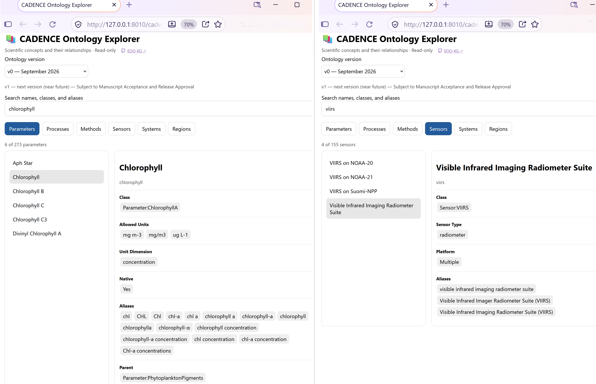

# EOO-KG: Earth Observation Ontology for Knowledge Graphs

<h3>Associated Scientific Manuscript</h3>

<blockquote>
  <strong>CADENCE-EOO: A Corpus-Guided Earth Observation Ontology</strong><br>
  Prasanjit Dash and Paul M. DiGiacomo<br>
  <em>Manuscript in preparation for
  <a href="https://link.springer.com/journal/12145">Earth Science Informatics</a>
  (Springer Nature), November 2026</em>
</blockquote><br>

EOO-KG provides governed scientific concepts for Earth observation (EO), developed within **CADENCE (Cognitive Analysis by Data-Enabled Neural Computation and Evaluation)**.


## Ontology

Eight resources: **parameters, processes, methods, regions, sensors, systems, units, and scientific trends**. They support canonical identities, alias resolution, explicit semantic relationships, deterministic validation, and interoperability.

For the scientific design, see [Architecture Overview](architecture.md).

| Version | Snapshot       | Basis                                                      | Release status                                                      |
| ------- | -------------- | ---------------------------------------------------------- | ------------------------------------------------------------------- |
| `v0`    | September 2026 | Manuscript-associated ontology; 101 research papers        | Initial public release |
| `v1`    | Next version   | Corpus-guided vocabulary expansion | **Provisional — not released**              |

### Version summaries

**v0: September 2026 (manuscript-associated snapshot).** Developed and evaluated using 101 Earth observation research documents. The verified snapshot comprises **8 vocabulary maps, 2,554 entries, 1,653 distinct canonical class values, 3,481 alias values, 653 parent assignments, and 272 unit assignments**. These figures agree with Table 2 of the CADENCE-EOO manuscript.

**v1: November 2026 working snapshot (PROVISIONAL; NOT RELEASED).** A subsequent ontology expansion informed by approximately 500,000 Earth observation question–answer records. The working snapshot comprises **8 vocabulary maps, 3,180 entries, 2,075 canonical class values, 3,942 alias values, 766 parent assignments, and 329 unit assignments**. All v1 figures are **provisional and subject to further curation and validation**.

<table>
<thead>
<tr><th align="left">Vocabulary resource</th><th align="right">v0 — September 2026<br>MANUSCRIPT-ASSOCIATED</th><th align="right">v1 — November 2026<br>PROVISIONAL — NOT RELEASED</th></tr>
</thead>
<tbody>
<tr><td>Methods</td><td align="right">379</td><td align="right">462</td></tr>
<tr><td>Parameters</td><td align="right">273</td><td align="right">331</td></tr>
<tr><td>Processes</td><td align="right">297</td><td align="right">373</td></tr>
<tr><td>Regions</td><td align="right">580</td><td align="right">697</td></tr>
<tr><td>Sensors</td><td align="right">155</td><td align="right">207</td></tr>
<tr><td>Systems</td><td align="right">352</td><td align="right">393</td></tr>
<tr><td>Trend tokens</td><td align="right">88</td><td align="right">100</td></tr>
<tr><td>Units</td><td align="right">430</td><td align="right">617</td></tr>
<tr><td><strong>Total</strong></td><td align="right"><strong>2,554</strong></td><td align="right"><strong>3,180</strong></td></tr>
</tbody>
</table>

The November 2026 working snapshot represents a **24.5% increase in vocabulary entries** relative to v0. These counts describe ontology vocabulary coverage, not independently validated improvements in scientific accuracy or completeness.

**Version evolution.** The CADENCE-EOO manuscript evaluates v0; v1 is a separate expanded snapshot and is not part of the manuscript's evaluation. Further versions may be developed through successive batches of scientific literature and curated Earth observation corpora, with each release subject to scientific adjudication, validation, and version control.

The `ontology/cadence_eoo_manifest.json` identifies the default version and distinguishes available datasets from planned releases. Only available versions can be loaded by the Explorer; v1 remains visible as a disabled future-version entry.


## Repository Structure

The v0 repository contains:

```text
EOO-KG/
├── README.md                          Documentation
├── LICENSE                            Dataset licensing terms
├── architecture.md                    Scientific architecture
├── cadence_eo_ontology_explorer.py    Read-only ontology explorer
├── assets/                            Diagrams and Explorer preview
└── ontology/
    ├── cadence_eoo_manifest.json      Version and release metadata
    └── v0/                            Eight v0 ontology JSON resources
```

The manifest identifies v1 as a planned version. Its ontology data are not distributed with v0.

## Explore v0

The eight JSON maps under `ontology/v0/` are the authoritative ontology snapshot and can be inspected directly without running software. To browse concepts, aliases, classes, and available relationships in the standalone local Explorer:

```cmd
python -m pip install fastapi uvicorn
python cadence_eo_ontology_explorer.py
```

Open http://127.0.0.1:8010/cadence-ontology/ (`-h` for options). The read-only Explorer browses six concept families; units and trends are supporting JSON resources. Select **v0 — September 2026**. The v1 entry is informational and disabled.

The Explorer binds to local loopback by default and is not intended to be exposed directly to the public Internet.

### Explorer preview — scientific ontology concepts

The CADENCE-EOO v0 Explorer illustrates class-aware browsing across six scientific concept families.

The examples show **Chlorophyll** (`Parameter:ChlorophyllA`), including its canonical identity, concentration units, aliases, and parent relationship, alongside **VIIRS** (`Sensor:VIIRS`), including its sensor classification, platform information, and aliases.

Both examples use the released September 2026 ontology (v0).



## Attribution & Release

**Scientific authors:** Prasanjit Dash and Paul M. DiGiacomo.
**Scientific quality control:** Human/expert adjudication.
**Coding assistance:** OpenAI ChatGPT.

The CADENCE-EOO manuscript evaluates the September 2026 ontology snapshot (`v0`). The subsequent expanded version (`v1`) incorporates additional corpus-derived scientific knowledge. Future versions may be developed through successive batches of scientific literature and curated Earth observation corpora, with each release reflecting governed vocabulary expansion, scientific adjudication, and validation.

**Citation:** Dash, P., and DiGiacomo, P. M., *CADENCE-EOO: A Corpus-Guided Earth Observation Ontology*, manuscript in preparation for *Earth Science Informatics*. For the ontology dataset, cite **CADENCE-EOO v0 (September 2026)** and the [EOO-KG repository](https://github.com/DrPDash/EOO-KG).

**License:** CADENCE-EOO v0 ontology datasets are licensed under [CC BY 4.0](https://creativecommons.org/licenses/by/4.0/). The Python Ontology Explorer is licensed under BSD-3-Clause. See [LICENSE](LICENSE) for licensing, attribution, and citation terms.

**Release status:** CADENCE-EOO `v0` is the initial public release, comprising the September 2026 ontology snapshot, supporting documentation, and the standalone, read-only Ontology Explorer (`cadence_eo_ontology_explorer.py`).
